<p align="center">
  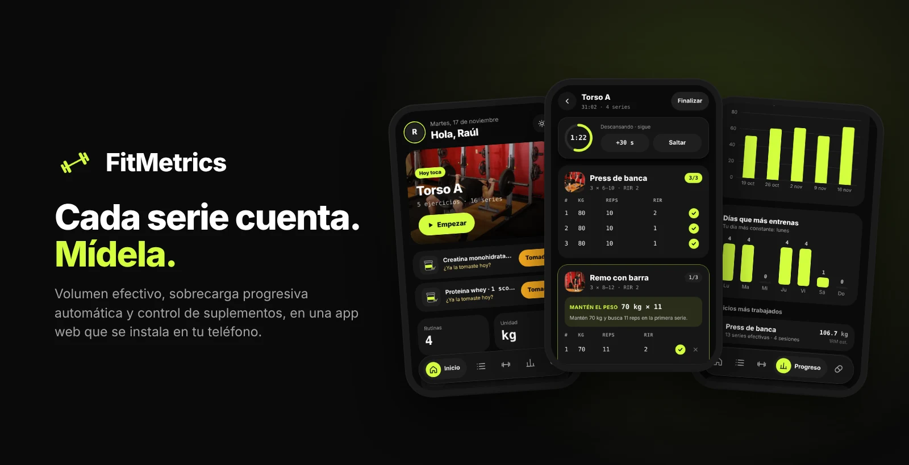
</p>

<p align="center">
  
  
  
  
  
  
  
</p>

# FitMetrics

**FitMetrics** es una app web para atletas de fuerza y fisicoculturismo. No solo guarda
tus series: las **interpreta**. Te dice qué peso usar hoy, cuántas series efectivas
lleva cada músculo en la semana, si te estancaste y cuándo se te va a acabar la creatina.

Está pensada para usarse en el teléfono, en medio del gimnasio: se instala como app,
funciona sin conexión y tiene tema oscuro y claro.

## Contenido

- [Capturas](#capturas)
- [Funciones](#funciones)
- [Cómo funciona](#cómo-funciona)
- [Arquitectura](#arquitectura)
- [Instalación](#instalación)
- [Pruebas](#pruebas)
- [Seguridad](#seguridad)
- [Hoja de ruta](#hoja-de-ruta)
- [Créditos](#créditos)

## Capturas

<table>
  <tr>
    <td align="center" width="33%">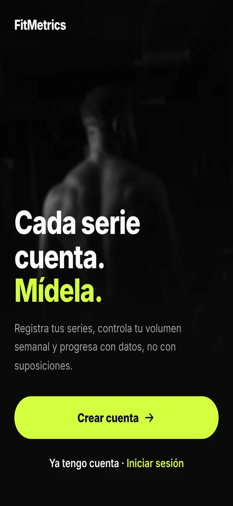<br><sub><b>Bienvenida</b>: lo primero que ves al abrir la app</sub></td>
    <td align="center" width="33%">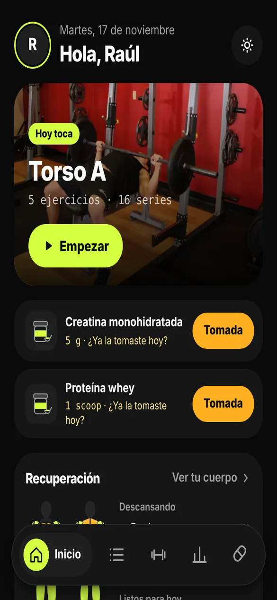<br><sub><b>Inicio</b>: la rutina de hoy y tus suplementos pendientes</sub></td>
    <td align="center" width="33%">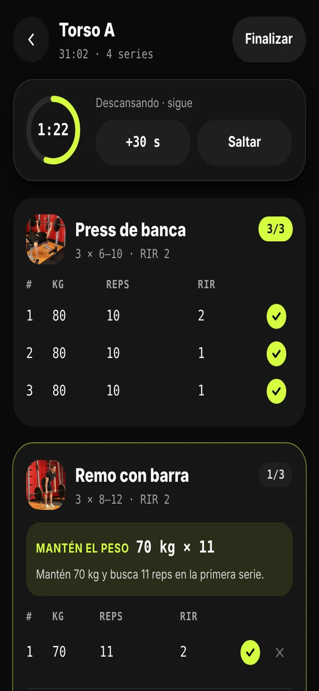<br><sub><b>Entrenar</b>: temporizador de descanso y sugerencia de peso para hoy</sub></td>
  </tr>
  <tr>
    <td align="center">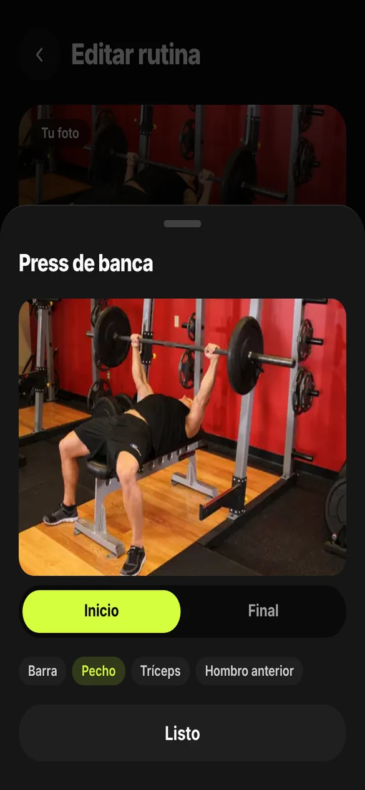<br><sub><b>Cómo se hace</b>: posición inicial y final de cada ejercicio</sub></td>
    <td align="center">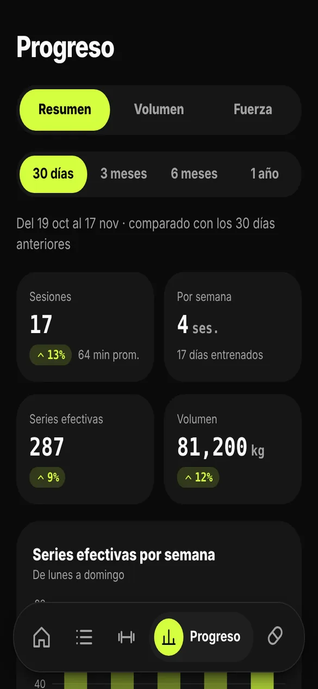<br><sub><b>Resumen</b>: tus números del mes contra el anterior</sub></td>
    <td align="center">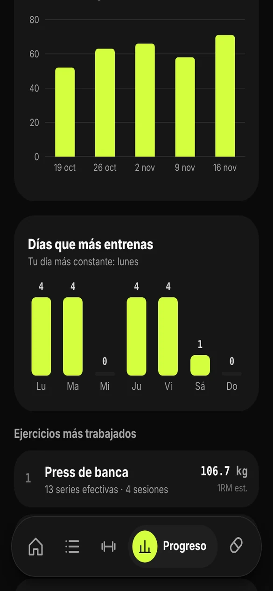<br><sub><b>Gráficas</b>: series por semana y tus días más constantes</sub></td>
  </tr>
  <tr>
    <td align="center">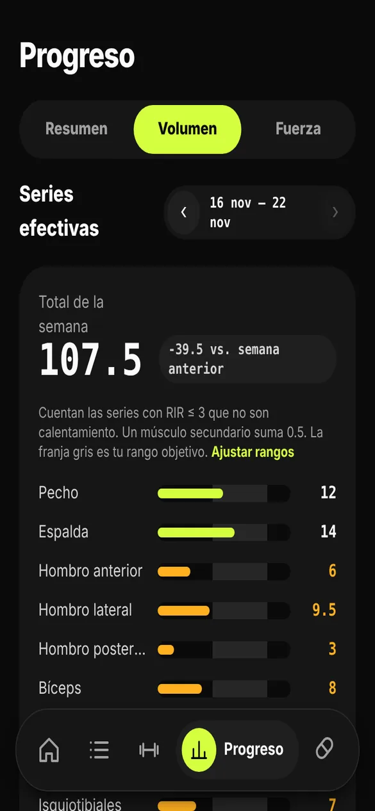<br><sub><b>Volumen</b>: series efectivas por músculo contra tu rango</sub></td>
    <td align="center">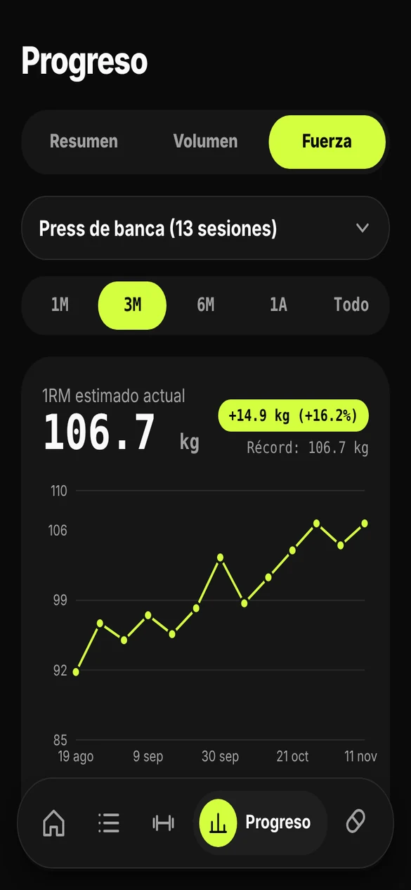<br><sub><b>Fuerza</b>: evolución de tu 1RM estimado</sub></td>
    <td align="center">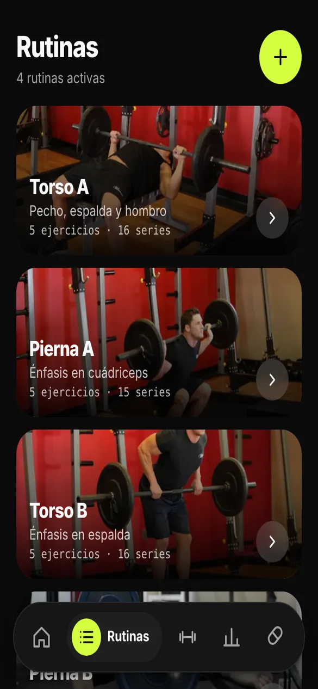<br><sub><b>Rutinas</b>: cada una con su foto</sub></td>
  </tr>
  <tr>
    <td align="center">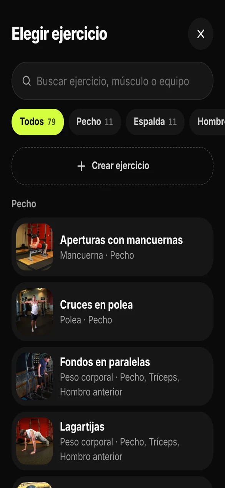<br><sub><b>79 ejercicios</b> con foto, por sección muscular</sub></td>
    <td align="center">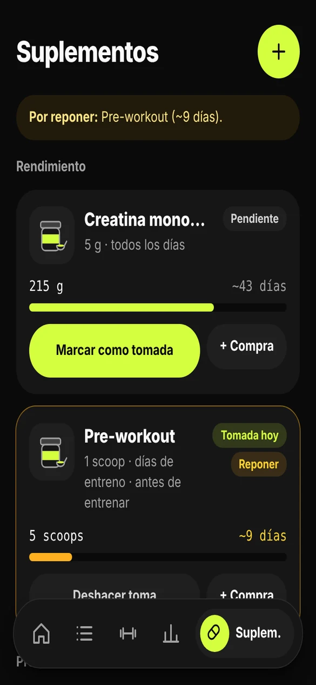<br><sub><b>Suplementos</b>: stock, días restantes y tomas</sub></td>
    <td align="center">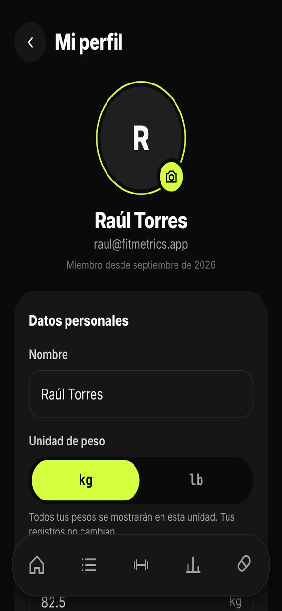<br><sub><b>Perfil</b>: foto, unidad kg/lb y contraseña</sub></td>
  </tr>
  <tr>
    <td align="center">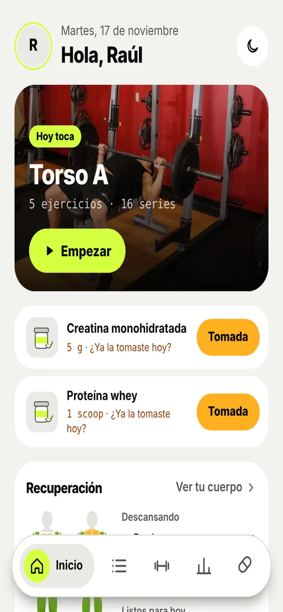<br><sub><b>Tema claro</b>: cambia con un toque</sub></td>
    <td align="center">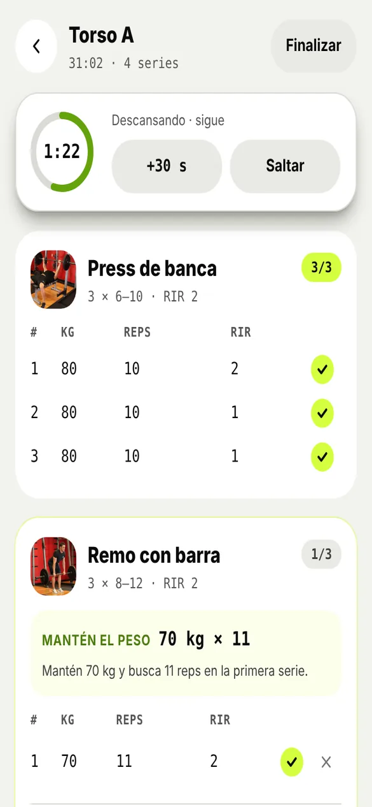<br><sub><b>Entrenar</b> en tema claro</sub></td>
    <td align="center">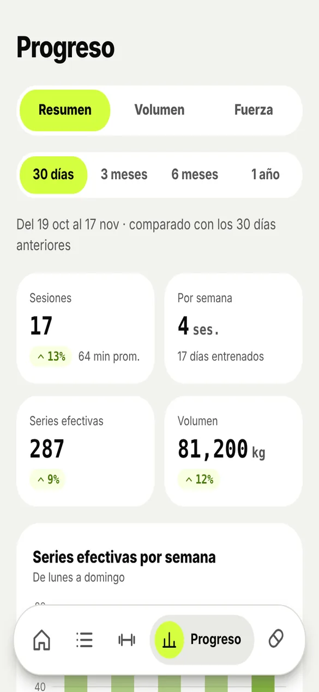<br><sub><b>Resumen</b> en tema claro</sub></td>
  </tr>
</table>

## Funciones

### 🏋️ Entrenamiento
- Rutinas con ejercicios, series, rango de repeticiones, RIR objetivo y descanso.
  Cada rutina tiene una foto aleatoria de gimnasio o la tuya.
- Registro de series en vivo, con temporizador de descanso que sigue corriendo aunque cierres la app.
- **Catálogo de 79 ejercicios** con foto, en 10 secciones musculares, y la vista
  **"Cómo se hace"**, que alterna la posición inicial y la final.
- Ejercicios propios, con sus músculos y su foto.
- Historial de entrenamientos con duración, volumen y fatiga percibida.

### 📈 Sobrecarga progresiva automática
- Para cada ejercicio, la app **sugiere el peso y las repeticiones de hoy** según tus
  últimas sesiones: subir, mantener o bajar.
- **Alerta de estancamiento** cuando tu 1RM estimado deja de subir.
- Funciona en kg o en lb, con saltos de peso reales para cada ejercicio.

### 📊 Progreso y reportes
- **Volumen semanal** de series efectivas por músculo, contra un rango que tú defines.
- **Fuerza**: evolución del 1RM estimado de cada ejercicio.
- **Resumen** de 30 días a 1 año: frecuencia, días que más entrenas, ejercicios
  principales y comparación con el periodo anterior.
- **Exportación** a PDF y a CSV para Excel.

### 💊 Suplementos
- Catálogo de 21 suplementos comunes con su dosis típica, o escritos a mano.
- Inventario con compras, tomas y **aviso de reposición**, calculado con tu
  frecuencia real de entrenamiento.
- **Recordatorios** en el inicio, antes de entrenar y al terminar.

### 📱 App
- **PWA instalable**: se agrega a la pantalla de inicio del iPhone o Android.
- **Funciona sin conexión**: consulta tus datos y fotos aunque no haya señal.
- Tema oscuro y claro, animaciones que respetan "Reducir movimiento" y aviso antes de actualizarse.

## Cómo funciona

| Concepto | Definición |
|---|---|
| **Serie efectiva** | Serie de trabajo (no de calentamiento) con **RIR ≤ 3** |
| **Volumen por músculo** | Cada serie efectiva suma **1** al músculo principal y **0.5** a los secundarios |
| **1RM estimado** | Fórmula de Epley: `peso × (1 + reps / 30)` |
| **Doble progresión** | Subes repeticiones dentro del rango; al completarlo, subes el peso |

Las reglas completas, con ejemplos, están en [**docs/reglas-sobrecarga.md**](docs/reglas-sobrecarga.md).

## Arquitectura

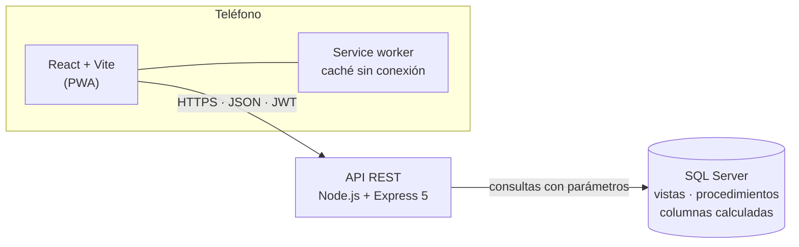

| Capa | Tecnología |
|---|---|
| **Frontend** | React 19, Vite 8, Tailwind CSS 4, React Router 7, Recharts, vite-plugin-pwa (Workbox) |
| **Backend** | Node.js, Express 5, mssql, JWT (jsonwebtoken), bcrypt, PDFKit, helmet, express-rate-limit |
| **Base de datos** | SQL Server: columnas calculadas persistidas, vistas, procedimientos almacenados y transacciones |
| **Pruebas** | `node:test` (backend) |

El backend sigue una arquitectura por capas: **rutas → controladores** (validan) **→ servicios**
(SQL y reglas de negocio) **→ utilidades** (cálculos puros, con pruebas).

```
FitMetrics/
├── database/           Scripts SQL: base inicial (01) y migraciones (02–10)
├── backend/
│   └── src/
│       ├── app.js          Arma la API (middlewares y rutas)
│       ├── server.js       La enciende
│       ├── config/         Conexión a SQL Server y seguridad
│       ├── routes/         Endpoints
│       ├── controllers/    Validación de datos
│       ├── services/       Consultas SQL y reglas de negocio
│       ├── middlewares/    Autenticación y límites de peticiones
│       └── utils/          Sobrecarga, reportes, suplementos… (con pruebas)
├── frontend/
│   ├── public/ejercicios/  Fotos de los ejercicios (WebP)
│   └── src/
│       ├── pages/          Pantallas
│       ├── components/     Componentes (ui/ = básicos reutilizables)
│       ├── context/        Sesión y tema
│       ├── services/       Cliente de la API
│       └── utils/          Formato, fechas, imágenes…
└── docs/               Documentación y capturas
```

La referencia de los 50+ endpoints está en [**docs/api.md**](docs/api.md).

## Instalación

### Requisitos

- [Node.js](https://nodejs.org/) 22 LTS (mínimo 20.19)
- [SQL Server](https://www.microsoft.com/sql-server/sql-server-downloads) 2019 o superior
  (la edición Express es gratuita) con TCP/IP activado en el puerto 1433
- [SQL Server Management Studio](https://learn.microsoft.com/sql/ssms/download-sql-server-management-studio-ssms) (SSMS)

### 1. Clonar

```bash
git clone https://github.com/raulchvzt/FitMetrics.git
cd FitMetrics
```

### 2. Base de datos

En SSMS, conectado con **Autenticación de Windows**, ejecuta los scripts de `database/`
**en orden**. Todos se pueden correr más de una vez sin romper nada.

| Script | Qué hace |
|---|---|
| `01_FitMetrics_BaseDeDatos.sql` | Crea la base, las tablas, las vistas, los procedimientos y los datos iniciales |
| `02_unidades_peso.sql` | Pesos con 3 decimales para convertir kg ↔ lb sin perder precisión |
| `03_fechas_utc.sql` | Guarda todas las fechas en UTC |
| `04_suplementos.sql` | Momento de la toma, hora de recordatorio y tamaño del envase |
| `05_perfil.sql` | Foto de perfil |
| `06_fotos_rutinas.sql` | Foto de cada rutina |
| `07_catalogo_ejercicios.sql` | Amplía el catálogo a 79 ejercicios |
| `08_imagenes_ejercicios.sql` | Relaciona cada ejercicio con sus fotos |
| `09_completar_catalogo.sql` | Agrega ejercicios originales si faltara alguno |
| `10_catalogo_suplementos.sql` | Catálogo, sección e ilustración de suplementos |
| `crear_usuario_app.sql` | Crea el usuario `fitmetrics_app` que usa la API (**cambia la contraseña**) |

### 3. Backend

```bash
cd backend
npm install
cp .env.example .env    # en Windows: copy .env.example .env
```

Llena el `.env`:

| Variable | Descripción |
|---|---|
| `DB_SERVER`, `DB_PORT`, `DB_NAME` | Dónde está SQL Server (`localhost`, `1433`, `FitMetrics`) |
| `DB_USER`, `DB_PASSWORD` | `fitmetrics_app` y la contraseña que pusiste en `crear_usuario_app.sql` |
| `JWT_SECRET` | **Mínimo 32 caracteres.** Genera uno con `node -e "console.log(require('crypto').randomBytes(48).toString('base64'))"` |
| `JWT_EXPIRES_IN` | Cuánto dura la sesión (`30d`) |
| `CORS_ORIGINS` | Dominios del frontend permitidos (en tu PC no hace falta cambiarlo) |
| `TRUST_PROXY` | Solo al publicar detrás de un proxy, normalmente `1` |

```bash
npm run dev     # http://localhost:3000
```

Revisa que responda en [http://localhost:3000/api/health](http://localhost:3000/api/health).

### 4. Frontend

```bash
cd frontend
npm install
npm run dev     # http://localhost:5173
```

Vite reenvía `/api` al backend, así que no hay que configurar nada más.

**En tu teléfono** (misma red WiFi): `npm run dev -- --host` y abre la dirección `Network` que aparece.

**Como PWA instalable y sin conexión**, prueba la versión compilada:

```bash
npm run build
npm run preview -- --host   # puerto 4173
```

> En iPhone, el modo sin conexión solo se activa con **HTTPS** (o en `localhost`).

### Scripts

| Carpeta | Comando | Qué hace |
|---|---|---|
| `backend` | `npm run dev` | API con recarga automática |
| `backend` | `npm start` | API en modo normal |
| `backend` | `npm test` | Pruebas automáticas |
| `frontend` | `npm run dev` | App en modo desarrollo |
| `frontend` | `npm run build` | Compila la app y genera el service worker |
| `frontend` | `npm run preview` | Sirve la versión compilada |
| `frontend` | `npm run lint` | Revisa el código con ESLint |

## Pruebas

```bash
cd backend
npm test
```

**46 pruebas** con el runner nativo de Node (`node:test`), sin base de datos:

- **Reglas de negocio:** sobrecarga y estancamiento, inventario de suplementos,
  agrupación de reportes, CSV, validación de imágenes y de ejercicios.
- **Seguridad:** encabezados, CORS, límite de intentos de login y firma del JWT.
  Estas levantan la API real en un puerto libre.

## Seguridad

- Contraseñas con **bcrypt**; el login tarda lo mismo exista o no el correo.
- **JWT** firmado con HS256 y secreto de al menos 32 caracteres.
- **Límite de intentos**: 10 logins cada 15 min por cuenta y conexión.
- **CORS** con lista de dominios permitidos y encabezados de seguridad con **helmet**.
- **Consultas con parámetros** en todo el backend (sin inyección SQL) y un usuario de
  SQL Server con **permisos mínimos**: no puede cambiar la estructura de la base.
- **Validación de imágenes** por su contenido real, no por lo que dice el archivo.
- CSV protegido contra **inyección de fórmulas** en Excel.
- Al cerrar sesión se borran los datos guardados para usar sin conexión.

## Hoja de ruta

- [x] **v1.0**: entrenamiento, sobrecarga, volumen, fuerza, suplementos, reportes, PWA y seguridad
- [ ] Publicar en internet (Vercel + Render + Azure SQL)
- [ ] Notificaciones push de suplementos a la hora elegida
- [ ] Registrar series sin conexión y enviarlas al recuperar la señal
- [ ] Pruebas automáticas del frontend
- [ ] Registro automático de migraciones aplicadas

## Créditos

- **Fotos de ejercicios:** [free-exercise-db](https://github.com/yuhonas/free-exercise-db),
  dominio público ([Unlicense](https://unlicense.org/)).
- **Fotos de rutinas:** [Unsplash](https://unsplash.com/license), de Benjamin Brunner,
  Nathan Dumlao, Ambitious Studio\* | Rick Barrett, Markus Spiske, Eduardo Cano Photo Co.
  y Victor Freitas.
- **Tipografías:** [Plus Jakarta Sans](https://fonts.google.com/specimen/Plus+Jakarta+Sans)
  y [JetBrains Mono](https://fonts.google.com/specimen/JetBrains+Mono) (SIL Open Font License).
- Las capturas usan datos de ejemplo.

---

Hecho por **Raúl** · [@raulchvzt](https://github.com/raulchvzt)

Todos los derechos reservados.
