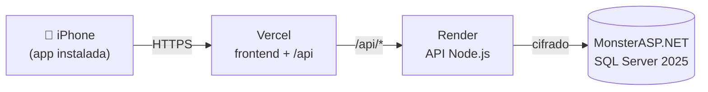

# Despliegue gratis en la nube

Cómo está publicada FitMetrics en **[fitmetrics-rose.vercel.app](https://fitmetrics-rose.vercel.app)**
sin pagar nada y sin tarjeta de crédito.



| Parte | Servicio | Plan gratis |
|---|---|---|
| Frontend (la app) | **Vercel** | Hobby |
| API (backend) | **Render** | Free: 750 h al mes; se duerme tras 15 min sin uso |
| Base de datos | **MonsterASP.NET** | Free: 1 base SQL Server 2025 de 1 GB con acceso remoto, sin tarjeta |

Vercel también hace de puente: la app llama a `/api/...` en su propio dominio y Vercel lo
reenvía a Render (`frontend/vercel.json`). Así no hay problemas de CORS y el modo sin
conexión funciona igual que en tu PC.

> **Lo que hay que saber del plan gratis.** Si nadie usa la app en 15 minutos, Render se duerme.
> La primera vez que la abras después tardará **hasta 1 minuto** en responder (la app muestra
> "Despertando el servidor"). Luego va rápida mientras la uses.

---

## Paso 1 · App en Vercel

1. Entra a **[vercel.com](https://vercel.com)** con tu cuenta de GitHub.
2. **Add New… → Project** → importa **FitMetrics**.
3. **Root Directory**: `frontend`. Vercel detecta Vite solo. **Deploy**.
4. Anota la dirección que te da (en este proyecto: `https://fitmetrics-rose.vercel.app`).
   Se puede cambiar en **Settings → Domains**.

Hasta terminar el paso 3 la app abre, pero el inicio de sesión falla: todavía no hay API.

---

## Paso 2 · API en Render

1. Entra a **[render.com](https://render.com)** con tu cuenta de GitHub.
2. **New** → **Blueprint** → elige el repositorio **FitMetrics**. Render lee
   [`render.yaml`](../render.yaml) y prepara el servicio `fitmetrics-api` (plan Free).
3. Te pedirá algunos valores. Los de la base todavía no los tienes: pon `pendiente`
   y los cambias en el paso 3.

   | Variable | Valor |
   |---|---|
   | `DB_SERVER`, `DB_NAME`, `DB_USER`, `DB_PASSWORD` | `pendiente` por ahora |
   | `CORS_ORIGINS` | tu dirección de Vercel, sin `/` al final |

   El resto ya viene en `render.yaml` (`JWT_SECRET` lo genera Render solo).
4. **Apply**. Copia la dirección del servicio (arriba, bajo el nombre). Si `fitmetrics-api`
   ya estaba ocupado, Render agrega letras al final: la de este proyecto es
   `https://fitmetrics-api-wme2.onrender.com`. **Esa dirección debe ser la misma que está en
   [`frontend/vercel.json`](../frontend/vercel.json)**; si es otra, cámbiala ahí.
5. Prueba `https://<tu-servicio>.onrender.com/api/health` → `{"estado":"ok"}`.

---

## Paso 3 · Base de datos en MonsterASP.NET

### 3.1 Crear la base

1. Crea una cuenta en **[monsterasp.net](https://www.monsterasp.net/ASP.NET-Freehosting/)**
   (plan **Free**, no pide tarjeta).
2. **Create new service → Database**:
   - Tipo: **SQL Server 2025**.
   - Collation: `SQL_Latin1_General_CP1_CI_AS` (la que viene).
   - User language: English.
3. En la base, pestaña **Remote access** → **Enabled**. Anota:
   - **Server**: algo como `db81363.public.databaseasp.net`.
   - **Login**: el nombre de la base (`db81363`).
   - **Password**: dale **Change** y pon una contraseña tuya, sin `;` ni comillas.

> MonsterASP **bloquea tu IP** si fallas el inicio de sesión varias veces seguidas.
> Copia y pega la contraseña en lugar de escribirla.

### 3.2 Copiar tu base local (estructura y datos)

En **SSMS conectado a tu SQL Server local**:

1. Clic derecho en **FitMetrics** → **Tareas** → **Generar scripts…**
2. **Elegir objetos**: *Seleccionar objetos específicos de la base de datos* y marca **todo**
   (tablas, vistas, procedimientos…). Así el script no intenta crear una base nueva.
3. **Establecer opciones de scripting**:
   - *Guardar como archivo de script* → *Archivo de script único* → *Texto Unicode*.
   - **Avanzadas**:
     - **Tipos de datos que se van a incluir en el script**: *Esquema y datos*
       (para empezar en blanco: *Solo esquema*).
     - **Incluir USE DATABASE**: *False*.
4. Guárdalo, por ejemplo, como `fitmetrics_nube.sql`.

Ahora **conecta SSMS a MonsterASP** (*Conectar → Motor de base de datos*):

| Campo | Valor |
|---|---|
| Nombre del servidor | el *Server* del paso 3.1 |
| Autenticación | Autenticación de SQL Server |
| Inicio de sesión / contraseña | los del paso 3.1 |
| Nombre de la base de datos | el nombre de tu base (`db81363`) |
| Cifrar | Obligatorio, con **Certificado de servidor de confianza** marcado |

Abre `fitmetrics_nube.sql`, revisa que arriba esté seleccionada tu base (no `master`) y que
la conexión sea la de MonsterASP (no `localhost`), y ejecútalo (F5).

Al principio sale un error por el usuario `fitmetrics_app`: es normal, ese usuario solo existe
en tu PC. En la nube la API usa el usuario de MonsterASP.

Para comprobar que se copió todo:

```sql
SELECT 'Usuarios' AS Tabla, COUNT(*) AS Filas FROM Usuarios
UNION ALL SELECT 'Ejercicios', COUNT(*) FROM Ejercicios
UNION ALL SELECT 'Sesiones', COUNT(*) FROM Sesiones
UNION ALL SELECT 'Series', COUNT(*) FROM Series;
```

### 3.3 Conectar Render con la base

En Render → **fitmetrics-api** → **Environment**:

| Variable | Valor |
|---|---|
| `DB_SERVER` | `db81363.public.databaseasp.net` |
| `DB_NAME` | `db81363` |
| `DB_USER` | `db81363` |
| `DB_PASSWORD` | la contraseña del paso 3.1 |
| `DB_ENCRYPT` | `true` (ya viene) |
| `DB_TRUST_SERVER_CERT` | `true` (ya viene: MonsterASP usa un certificado propio) |

Guarda; Render vuelve a desplegar solo. Prueba:

- `https://<tu-servicio>.onrender.com/api/health/db` → `{"estado":"ok","baseDatos":"conectada"}`

---

## Paso 4 · Instalarla en el iPhone

1. Abre **[fitmetrics-rose.vercel.app](https://fitmetrics-rose.vercel.app)** en **Safari**.
2. **Compartir** → **Agregar a pantalla de inicio**.
3. Inicia sesión con tu cuenta de siempre.

Si tenías instalada la versión de tu PC, bórrala primero.

---

## Actualizaciones

Cada merge a `main` publica solo: Vercel y Render vuelven a construir la app, y la app
instalada muestra **"Hay una versión nueva"**.

Si una actualización trae una **migración SQL nueva**, córrela en MonsterASP con SSMS
(tu base seleccionada) **antes** del merge. Las migraciones empiezan con `USE FitMetrics;`:
en la nube quita esa línea y su `GO`, porque la base se llama distinto.

Tu base local y la de la nube ya son independientes: lo que registres en el iPhone se guarda
solo en la nube.

## Problemas comunes

| Síntoma | Causa y solución |
|---|---|
| "Despertando el servidor" casi un minuto | Normal en el plan gratis tras 15 min sin uso. |
| La página de carga de Render se repite sin fin | Estás abriendo otra dirección: revisa la de tu servicio (con sus letras al final). |
| `/api/health` dice "Ruta no encontrada" | Le falta `/api` o tiene un error de escritura. |
| `Login failed for user` (18456) | Contraseña o usuario incorrectos. No insistas: MonsterASP bloquea la IP tras varios intentos. |
| `/api/health/db` da error | Revisa `DB_SERVER`, `DB_NAME`, `DB_USER` y `DB_PASSWORD` en Render, y que *Remote access* siga en **Enabled**. Los **Logs** de Render dicen el error exacto. |
| Inicias sesión en una cuenta vacía | Copiaste solo la estructura. Repite el paso 3.2 con *Esquema y datos*. |
