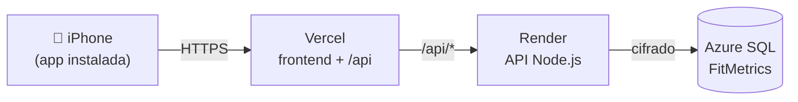

# Despliegue gratis en la nube

Guía para publicar FitMetrics sin pagar nada y usarla en el iPhone desde cualquier lugar.

| Parte | Servicio | Plan gratis |
|---|---|---|
| Frontend (la app) | **Vercel** | Hobby: sin límite práctico para un proyecto personal |
| API (backend) | **Render** | Free: 750 h al mes; se duerme tras 15 min sin uso |
| Base de datos | **Azure SQL Database** | Free: 100,000 segundos de vCore y 32 GB al mes; se pausa tras 15 min sin uso |

Vercel también hace de puente: la app llama a `/api/...` en su propio dominio y Vercel lo
reenvía a Render (`frontend/vercel.json`). Así no hay problemas de CORS y el modo sin
conexión sigue funcionando igual que en tu PC.

> **Lo que hay que saber del plan gratis.** Si nadie usa la app en 15 minutos, Render y Azure
> se duermen. La primera vez que la abras después tardará **hasta 1 minuto** en responder
> (la app muestra "Despertando el servidor"). Luego va rápida mientras la uses.

---

## Paso 1 · Base de datos en Azure SQL

### 1.1 Crear la cuenta

- Como estudiante del TecNM puedes usar **Azure for Students** con tu correo institucional:
  no pide tarjeta. (La versión *Students Starter* no incluye la base gratis).
- Si no, crea una cuenta normal de Azure (pide tarjeta solo para verificar; la base gratis no cobra).

### 1.2 Crear la base gratis

1. Entra a **[aka.ms/azuresqlhub](https://aka.ms/azuresqlhub)** y en *Create a database*
   elige **Start free**.
2. En **Basics**:
   - **Resource group**: crea uno nuevo, `fitmetrics`.
   - **Database name**: `FitMetrics` (exactamente así).
   - **Server** → *Create new*:
     - **Server name**: algo único, por ejemplo `fitmetrics-raul` → queda
       `fitmetrics-raul.database.windows.net`.
     - **Location**: **(US) East US** (Render estará en Virginia, al lado).
     - **Authentication method**: *Use SQL authentication*. Crea un usuario administrador
       y una contraseña fuerte. **Guárdalos**: son solo para ti (SSMS), la app usará otro usuario.
   - **Behavior when free limit reached**: **Auto-pause the database until next month**.
     ⚠️ Muy importante: con esta opción **nunca te cobran**. No elijas *Continue using database
     for additional charges*.
   - Revisa que **Estimated Cost/Month** diga **0**.
3. En **Networking**:
   - **Connectivity method**: *Public endpoint*.
   - **Add current client IP address**: *Yes* (para conectarte desde tu PC con SSMS).
   - **Allow Azure services and resources to access this server**: *No*.
4. **Review + create** → **Create**. Tarda unos minutos.

### 1.3 Copiar tu base local a Azure (estructura y datos)

En **SSMS conectado a tu SQL Server local**:

1. Clic derecho en **FitMetrics** → **Tasks** → **Generate Scripts…**
2. **Choose Objects**: *Script entire database and all database objects*.
3. **Set Scripting Options** → **Advanced**:
   - **Script for the database engine type**: *Microsoft Azure SQL Database*.
   - **Types of data to script**: *Schema and data* (si quieres empezar en blanco: *Schema only*).
   - **Script USE DATABASE**: *False*.
4. Guárdalo como archivo, por ejemplo `fitmetrics_azure.sql`.

Ahora **conecta SSMS a Azure** (*Connect → Database Engine*):

- **Server name**: `fitmetrics-raul.database.windows.net`
- **Authentication**: *SQL Server Authentication* con el administrador del paso 1.2
- **Encryption**: *Mandatory*

Abre `fitmetrics_azure.sql`, elige la base **FitMetrics** en la lista de arriba (no `master`)
y ejecútalo (F5).

### 1.4 Crear el usuario de la app

Con la misma conexión a Azure y la base **FitMetrics** seleccionada, abre
[`database/azure/usuario_app_azure.sql`](../database/azure/usuario_app_azure.sql), cambia
`CAMBIA_ESTA_CONTRASEÑA_1!` por una contraseña nueva y ejecútalo. Esa contraseña va en Render.

Al terminar, **desconéctate de Azure en SSMS**: una conexión abierta no deja que la base se pause
y gasta el tiempo gratis.

---

## Paso 2 · API en Render

1. Entra a **[render.com](https://render.com)** con tu cuenta de GitHub.
2. **New** → **Blueprint** → elige el repositorio **FitMetrics**. Render lee
   [`render.yaml`](../render.yaml) y prepara el servicio `fitmetrics-api` (plan Free, Virginia).
3. Te pedirá 3 valores:

   | Variable | Valor |
   |---|---|
   | `DB_SERVER` | `fitmetrics-raul.database.windows.net` |
   | `DB_PASSWORD` | la contraseña de `fitmetrics_app` (paso 1.4) |
   | `CORS_ORIGINS` | por ahora `https://fitmetrics.vercel.app`; lo corriges en el paso 3 |

   El resto ya viene en `render.yaml` (`JWT_SECRET` lo genera Render solo).
4. **Apply**. Cuando termine, copia la dirección del servicio (arriba, bajo el nombre).
   Si `fitmetrics-api` ya estaba ocupado, Render agrega letras al final: la de este proyecto es
   `https://fitmetrics-api-wme2.onrender.com`. Esa dirección debe ser la misma que está en
   [`frontend/vercel.json`](../frontend/vercel.json).

### 2.1 Dejar entrar a Render en el firewall de Azure

Render todavía no puede llegar a la base: Azure solo deja entrar a tu PC.

1. En Render abre el servicio → botón **Connect** (arriba a la derecha) → pestaña **Outbound**.
   Verás rangos como `74.220.48.0/24`.
2. En Azure: tu servidor SQL → **Security → Networking** → **Add a firewall rule** por cada rango.
   Un `/24` va del `.0` al `.255`: `74.220.48.0/24` → inicio `74.220.48.0`, fin `74.220.48.255`.
3. **Save**.

### 2.2 Probar

- `https://fitmetrics-api-wme2.onrender.com/api/health` → `{"estado":"ok"}` (la API está encendida).
- `https://fitmetrics-api-wme2.onrender.com/api/health/db` → `{"estado":"ok","baseDatos":"conectada"}`.
  La primera vez puede tardar hasta un minuto porque la base estaba en pausa.

---

## Paso 3 · App en Vercel

1. Entra a **[vercel.com](https://vercel.com)** con tu cuenta de GitHub.
2. **Add New… → Project** → importa **FitMetrics**.
3. **Root Directory**: `frontend`. Vercel detecta Vite solo. **Deploy**.
4. En **Settings → Domains** puedes cambiar la dirección, por ejemplo
   `fitmetrics-raul.vercel.app`.
5. Regresa a Render → **Environment** → pon en `CORS_ORIGINS` tu dirección de Vercel
   (sin `/` al final) y guarda.

---

## Paso 4 · Instalarla en el iPhone

1. Abre tu dirección de Vercel en **Safari**.
2. **Compartir** → **Agregar a pantalla de inicio**.
3. Inicia sesión con tu cuenta de siempre (si copiaste los datos en el paso 1.3).

Si ya la tenías instalada desde tu PC, bórrala y agrégala de nuevo desde la dirección de Vercel.

---

## Actualizaciones

Cada merge a `main` publica solo: Vercel y Render vuelven a construir la app. La app instalada
mostrará el aviso **"Hay una versión nueva"**.

Si una actualización trae una migración SQL nueva, córrela en Azure con SSMS (base
**FitMetrics** seleccionada) **antes** de hacer el merge. Las migraciones que empiezan con
`USE FitMetrics;` se corren igual: en Azure quita esa línea y su `GO`.

## Problemas comunes

| Síntoma | Causa y solución |
|---|---|
| "Despertando el servidor" casi un minuto | Normal en el plan gratis tras 15 min sin uso. |
| `/api/health/db` da error de firewall o *Cannot open server* | Falta un rango de Render en el firewall de Azure (paso 2.1). |
| *Login failed for user 'fitmetrics_app'* | La contraseña de `DB_PASSWORD` no es la del paso 1.4, o el script se corrió en `master`. |
| La app dice "El servidor está despertando" y no pasa | Revisa los *Logs* del servicio en Render. |
| La base quedó en pausa hasta el próximo mes | Se acabaron los 100,000 segundos gratis. Vuelve el día 1; o desconecta SSMS cuando no lo uses para no gastarlos. |
| Inicias sesión en una cuenta vacía | Copiaste solo la estructura. Repite el paso 1.3 con *Schema and data*. |
